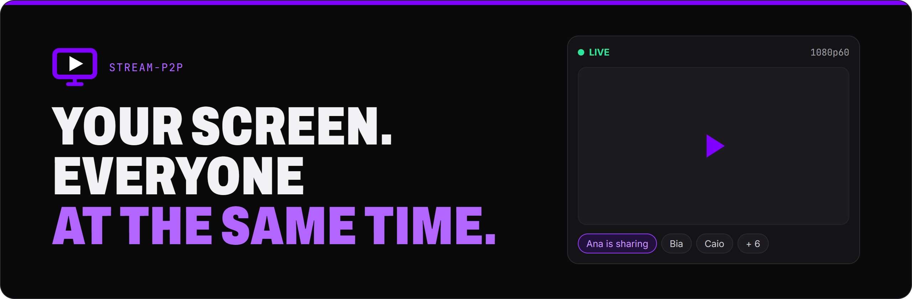
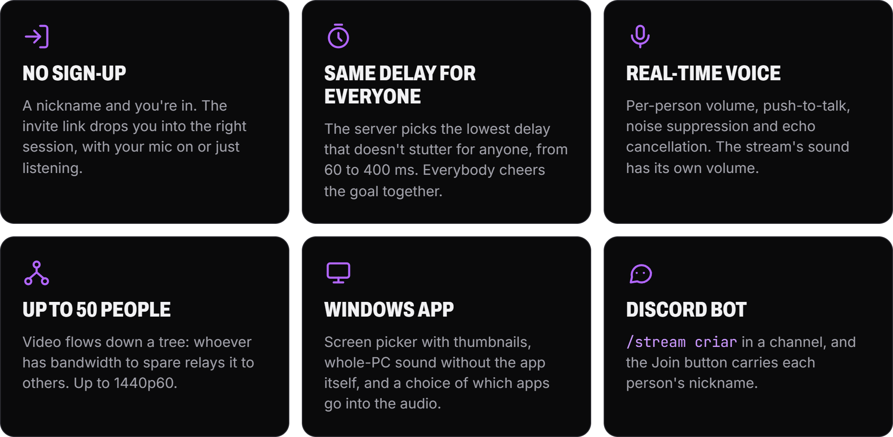
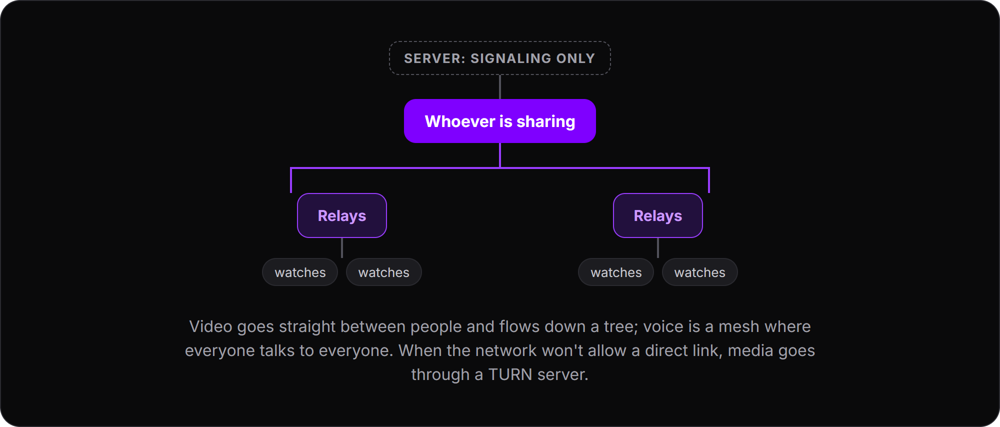
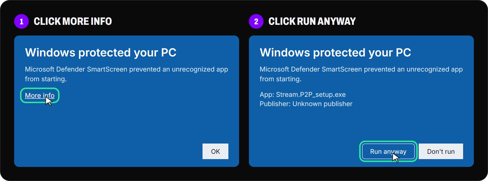

<p align="center"><a href="README.md">Português</a> · <strong>English</strong></p>

<p align="center">
  
</p>

<p align="center">
  <a href="https://github.com/yagoriccomi/stream-p2p/releases/latest"></a>
  <a href="LICENSE"></a>
  
  
  
  
</p>

<p align="center">
  <a href="https://stream.yagoriccomi.com.br"></a>
  <a href="https://github.com/yagoriccomi/stream-p2p/releases/latest"></a>
  <a href="https://stream.yagoriccomi.com.br/discord/install"></a>
</p>

<p align="center">
  One person shares, everyone else watches and talks over voice.<br>
  It runs in the browser, on your phone as an app, and on Windows with its own app.<br>
  Nobody signs up: pick a nickname and send the link. The interface is in Portuguese.
</p>

## What's good about it



## How it works



## Use it now

1. Open [stream.yagoriccomi.com.br](https://stream.yagoriccomi.com.br), type a nickname and click **Criar sessão** (create session).
2. Send the invite link to your friends.
3. Click **Transmitir** (share), pick the screen and the quality. Anyone who wants a turn clicks **Pedir a vez** (ask for a turn).

On a phone you can watch and talk: on Android, **Install app**; on iPhone, **Share › Add to Home Screen**.

## Installing the Windows app

The installer is not code-signed yet, so Windows shows a warning the first time. Click **More info**, then **Run anyway**. It installs for your user only, without asking for administrator rights.



## On Discord

| Command | What it does |
|---|---|
| `/stream criar` | Opens a session and posts the Join button |
| `/stream status` | Who is in each session and who is sharing |
| `/stream convite` | Posts the last session's button again |
| `/stream encerrar` | Ends the last session you created there |
| `/stream app` | Link to download the Windows app |
| `/stream help` | Explains the features and gives tips |
| Right-click › Apps › **Chamar para stream** | Calls the person and sends them the link by DM |

## Run it locally

```bash
npm install
npm test     # sessions, permissions, turn queue, tree, Discord bot
npm start    # http://localhost:3000
```

```text
server/   signaling, sessions, video tree, Discord bot
web/      the site (also a PWA on phones)
app/      Windows app (Tauri 2, Rust)
worker/   the bot's front door (Cloudflare Worker)
e2e/      browser tests with a simulated network
docs/     technical docs, plans, delivery notes and brand
```

Testing and deploying the server, the app and the bot: [technical docs](docs/TECNICO.md) (in Portuguese).

<details>
<summary><strong>Known limitations</strong></summary>

State lives in memory (restarting the server ends the sessions), relays re-encode in the browser, and there is no native NVENC/AMF encoder yet. The full list is under [Limitações](docs/TECNICO.md#limitações) (in Portuguese).

</details>

---

<p align="center">Made by <a href="https://github.com/yagoriccomi">Yago Riccomi</a> · <a href="LICENSE">GPL-3.0</a> license</p>
