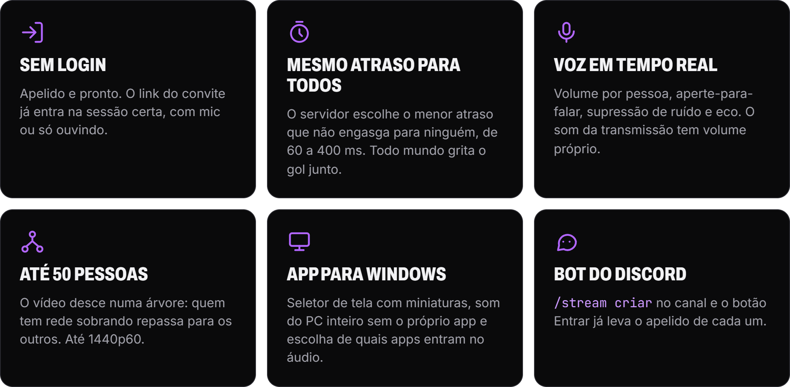
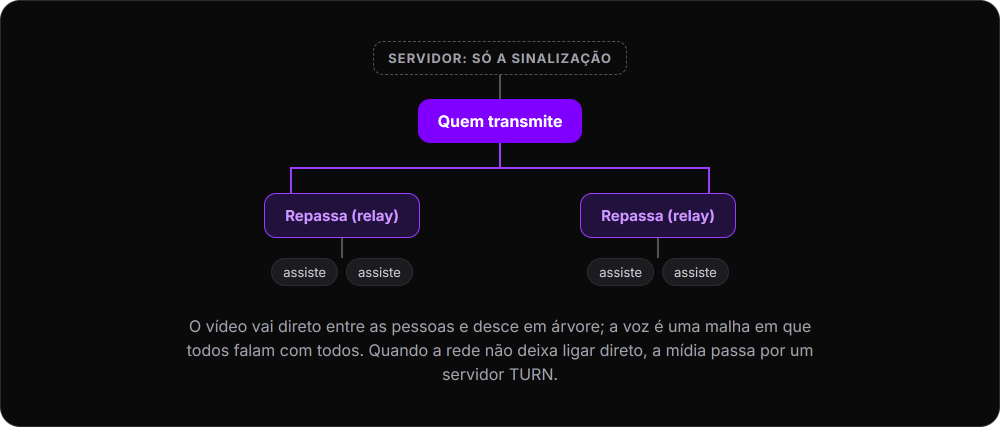
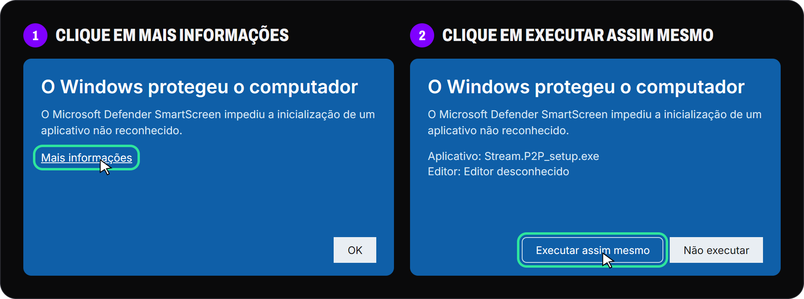

<p align="center"><strong>Português</strong> · <a href="README.en.md">English</a></p>

<p align="center">
  
</p>

<p align="center">
  <a href="https://github.com/yagoriccomi/stream-p2p/releases/latest"></a>
  <a href="LICENSE"></a>
  
  
  
  
</p>

<p align="center">
  <a href="https://stream.yagoriccomi.com.br"></a>
  <a href="https://github.com/yagoriccomi/stream-p2p/releases/latest"></a>
  <a href="https://stream.yagoriccomi.com.br/discord/install"></a>
</p>

<p align="center">
  Uma pessoa transmite, o resto assiste e conversa por voz.<br>
  Funciona no navegador, no celular como app e no Windows com app próprio.<br>
  Ninguém cria conta: digite um apelido e mande o link.
</p>

## O que tem de bom



## Como funciona



## Usar agora

1. Abra [stream.yagoriccomi.com.br](https://stream.yagoriccomi.com.br), digite um apelido e clique **Criar sessão**.
2. Mande o link do convite para a galera.
3. Clique **Transmitir**, escolha a tela e a qualidade. Quem quiser a vez clica **Pedir a vez**.

No celular dá para assistir e falar: no Android, **Instalar app**; no iPhone, **Compartilhar › Adicionar à Tela de Início**.

## Instalar o app para Windows

O instalador ainda não tem assinatura de código, então o Windows mostra um aviso na primeira vez. Clique em **Mais informações** e depois em **Executar assim mesmo**. Ele instala só para o seu usuário, sem pedir administrador.



## No Discord

| Comando | O que faz |
|---|---|
| `/stream criar` | Abre a sessão e posta o botão Entrar |
| `/stream status` | Quem está em cada sessão e quem transmite |
| `/stream convite` | Posta de novo o botão da última sessão |
| `/stream encerrar` | Encerra a última sessão que você criou ali |
| `/stream app` | Link para baixar o app para Windows |
| `/stream help` | Explica as funções e dá dicas |
| Clique direito › Apps › **Chamar para stream** | Chama a pessoa e manda o link por mensagem privada |

## Rodar na sua máquina

```bash
npm install
npm test     # sessão, permissões, fila de vez, árvore, bot do Discord
npm start    # http://localhost:3000
```

```text
server/   sinalização, sessões, árvore de vídeo, bot do Discord
web/      o site (também PWA no celular)
app/      app para Windows (Tauri 2, Rust)
worker/   porta de entrada do bot (Cloudflare Worker)
e2e/      testes com navegador e rede simulada
docs/     documentação técnica, planos, entregas e marca
```

Como testar, publicar o servidor, o app e o bot: [documentação técnica](docs/TECNICO.md).

<details>
<summary><strong>Limitações conhecidas</strong></summary>

O estado fica em memória (reiniciar o servidor encerra as sessões), o relay re-codifica no navegador e ainda não há encoder NVENC/AMF nativo. A lista completa está em [Limitações](docs/TECNICO.md#limitações).

</details>

---

<p align="center">Feito por <a href="https://github.com/yagoriccomi">Yago Riccomi</a> · licença <a href="LICENSE">GPL-3.0</a></p>
